# Hebrew Practice · עִבְרִית בַּשְּׁכוּנָה

**▶ Open the app: [rmagid1010.github.io/hebrew-practice](https://rmagid1010.github.io/hebrew-practice/)**

A free, no-sign-up website for learning the Hebrew people actually speak on the streets of Tel Aviv. It takes you from your first
*שָׁלוֹם* to confident A2 conversation, with a structured course, spaced repetition, and a strong focus on getting gender and
grammar right.

<p align="center">
  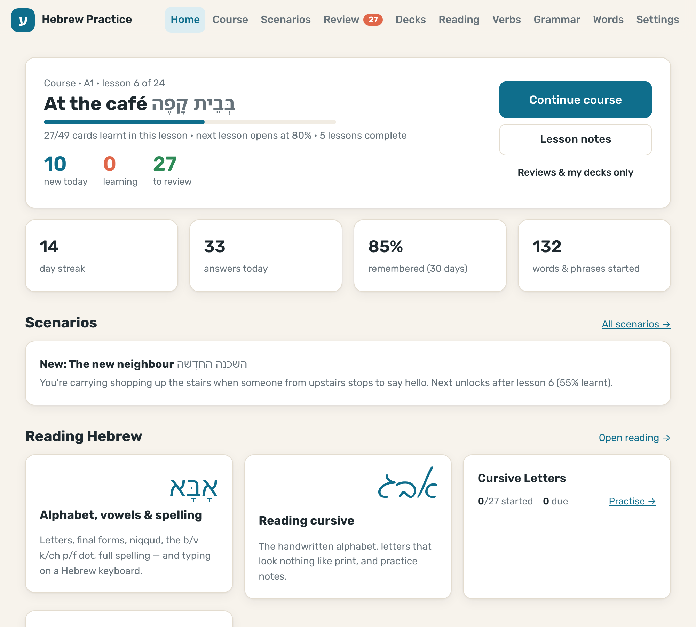
</p>

---

## Contents

- [What it is](#what-it-is)
- [Quick start (5 minutes)](#quick-start-5-minutes)
- [The manual](#the-manual)
  - [1. Home](#1-home)
  - [2. The course](#2-the-course)
  - [3. Reviewing cards](#3-reviewing-cards)
  - [4. The kinds of exercises](#4-the-kinds-of-exercises)
  - [5. Gender and agreement](#5-gender-and-agreement)
  - [6. Writing tasks](#6-writing-tasks)
  - [7. Scenarios](#7-scenarios)
  - [8. Verbs](#8-verbs)
  - [9. Reading Hebrew and cursive](#9-reading-hebrew-and-cursive)
  - [10. Grammar explainers](#10-grammar-explainers)
  - [11. Decks, Words and your own words](#11-decks-words-and-your-own-words)
  - [12. Settings](#12-settings)
  - [13. Your progress and backups](#13-your-progress-and-backups)
  - [Keyboard shortcuts](#keyboard-shortcuts)
  - [Tips and FAQ](#tips-and-faq)
- [For developers](#for-developers)

---

## What it is

- **A 24-lesson course from A1 to A2.** Each lesson mixes new words, verb forms and sentences, then asks you to write something
  yourself.
- **Spaced repetition.** It uses FSRS, the algorithm modern Anki uses: cards come back just before you'd forget them, so 15–20
  minutes a day is enough.
- **You produce Hebrew instead of just recognising it.** Most cards ask for Hebrew: you type it on your Hebrew keyboard, or build it
  from tiles while a card is new.
- **Gender is taken seriously.**
  - Every noun is learnt with זֶה / זֹאת / אֵלֶּה, so you learn its gender with it.
  - Sentences come in versions: you as a man or a woman, talking to a man, a woman or a group, and about "we", "they", "he" and "she".
  - A checker catches agreement mistakes in what you type.
- **Scenarios.** Realistic street conversations (neighbours, cafés, taxis, the doctor, the landlord…) where you answer in your own
  words.
- **Street Hebrew first.** Every word carries a slang / casual / neutral / formal tag, with notes on what Israelis really say.
- **Vowel points (niqqud) are shown but never required.** You type plain Hebrew, as everyone does.
- **Audio.** Tap the speaker on any card to hear it, using your device's Hebrew voice.
- **Works on a phone or a computer**, with light and dark themes.

> Your progress is saved **in your browser only**. Nothing is uploaded, and there's no account. See
> [Backups](#13-your-progress-and-backups).

---

## Quick start (5 minutes)

1. **Open [the app](https://rmagid1010.github.io/hebrew-practice/)** on the device you'll practise on most.
2. **Set up a Hebrew keyboard** if you haven't:
   - **iPhone:** Settings → General → Keyboard → Add New Keyboard → Hebrew.
   - **Mac:** System Settings → Keyboard → Input Sources → Hebrew.
   - **Windows:** Settings → Time & language → Language → Add Hebrew.
3. **Already know some Hebrew?** Go to **Settings → Start the course from** and pick the lesson you want to start at. Everything
   before it counts as known.
4. On **Home**, press **Continue course**. Answer each card, then grade yourself. The app suggests a grade, so pressing **Enter**
   is usually all you need.
5. **Come back every day.** Due reviews always come first, then new cards, up to your daily limit (10 by default).
6. When a lesson is about 80% learnt, its **scenario** opens. Try it.

---

## The manual

### 1. Home

The home page shows:

- **Your current lesson** and how much of it you've learnt. The next lesson opens at 80%.
- **Today's numbers:**
  - **new**: new cards still allowed today.
  - **learning**: cards you're in the middle of learning.
  - **to review**: cards that are due.
- **Three ways to study:**
  - **Continue course**: due reviews plus the next new cards from the course. This is what you'll use most.
  - **Lesson notes**: the short explanation for the lesson you're on.
  - **Reviews & my decks only**: due cards and any decks you've switched on yourself, with no new course material.
- **Your streak, today's answers, recall rate and an activity heatmap.**
- **Shortcuts** to the newest scenario, the reading section and grammar explainers.

The **Review** tab at the top shows a red badge with the number of cards due.

### 2. The course

<p align="center">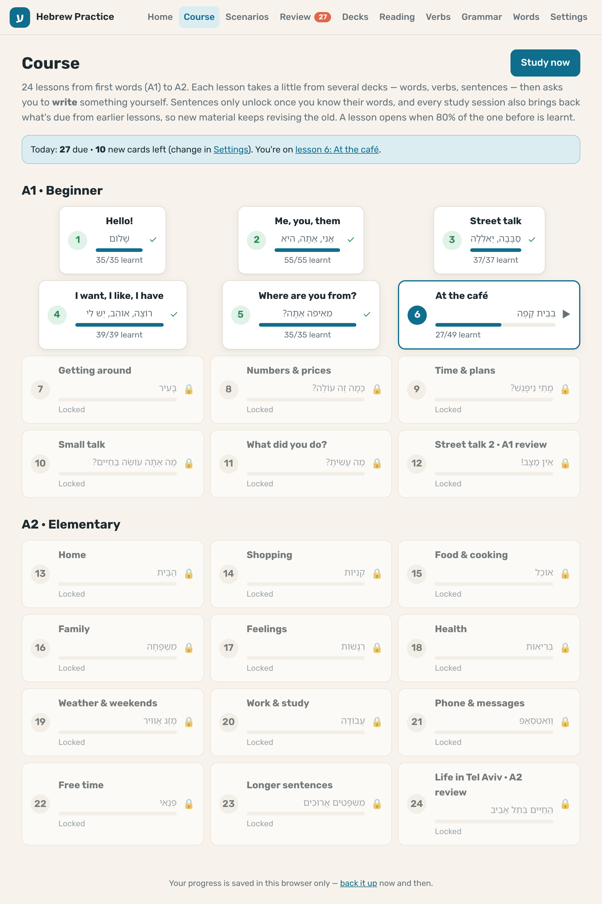</p>

The **Course** tab shows all 24 lessons:

- **A1 · Beginner, lessons 1–12:** greetings, people, street talk, wanting and liking, small talk, the café, getting around,
  numbers and prices, time and plans, the past, and a review lesson.
- **A2 · Elementary, lessons 13–24:** home, shopping, food, family, feelings, health, weather, work, phone and messages, free
  time, longer sentences, and a final review.

How the course moves you along:

- **A lesson opens when 80% of the lesson before it is learnt.**
- **Each lesson builds up step by step.** First the words, then the verb forms, then example sentences. A sentence only appears
  once you know the words in it.
- **Writing tasks come last.** You write something yourself using what the lesson taught.
- **Every study session also brings back due cards from earlier lessons**, so old material keeps getting revised.

Click a lesson to see its page:

<p align="center">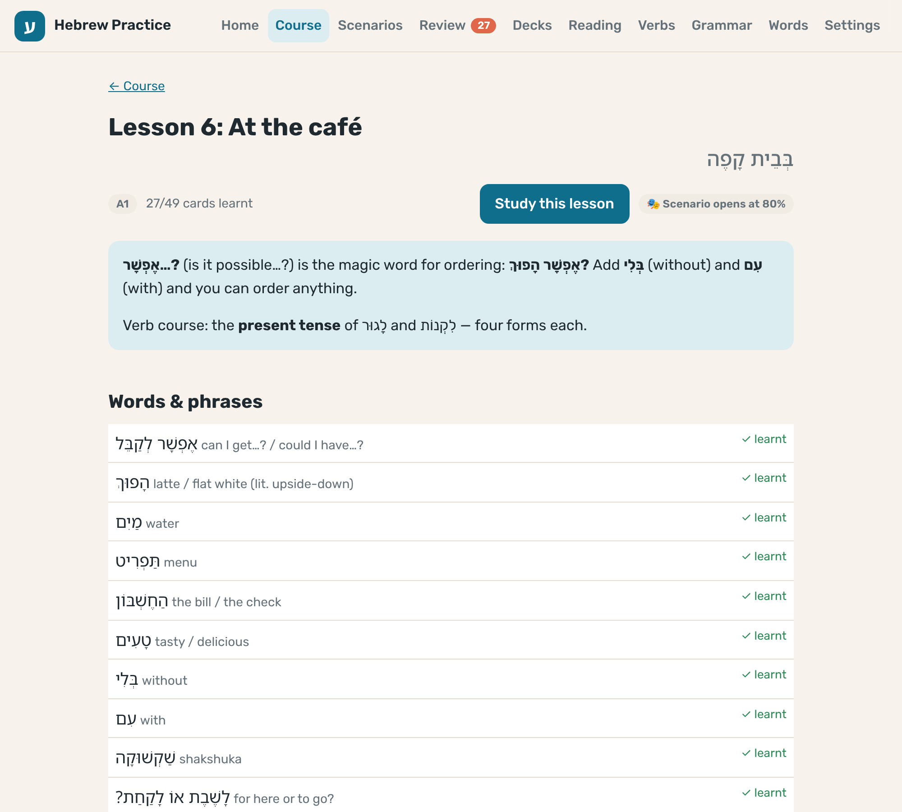</p>

- The **intro** explains the key grammar for the lesson in a few lines.
- **Study this lesson** drills just this lesson's cards.
- Every word, verb, sentence and writing task is listed with its status: new, learning, learnt, or locked with the reason.
- A **scenario** button appears once the lesson's scenario is open.

**Skipping ahead.** In **Settings → Start the course from**, choose a later lesson. All earlier lessons are marked *skipped*, and
everything in them counts as known. Their sentences, verbs and scenarios unlock straight away. You can move the starting point
back at any time.

### 3. Reviewing cards

Every card works the same way:

1. **Read the prompt.** It's usually English: write it in Hebrew.
2. **Answer.** Depending on how well you know the card, you choose, build or type the answer (see the next section).
3. **See the result.** You get one of three verdicts:
   - ✅ **Correct**
   - 🟧 **Almost**: a small slip, such as a wrong final letter (ך ם ן ף ץ) or a plene/defective spelling difference.
   - ❌ **Not quite**: you see what you wrote against the right answer, with the differences highlighted.
4. **Read the answer panel.** It has the Hebrew with vowel points, a 🔊 button, the plain spelling, other accepted answers, the
   other gender versions, notes and examples.
5. **Grade yourself:**
   - **Again**: you didn't know it. It comes back in a minute.
   - **Hard**: you got it, with difficulty.
   - **Good**: you knew it. The app usually suggests this one.
   - **Easy**: you knew it instantly.

   Each button shows when you'll see the card next. **Enter** accepts the suggested grade.

Other things you'll see on a card:

- **Badges** at the top: the card type, *new*, the register (slang / casual / neutral / formal) and the deck.
- **The counters** at the top right: new (blue), learning (red) and review (green) cards left in this session.
- **↶ Undo** (or **Z**), which takes back your last grade.
- **I don't know**, which shows the answer and counts as a miss.

Most words have two cards: **writing** (English → Hebrew) and **reading** (Hebrew → what does it mean?).

### 4. The kinds of exercises

New cards don't ask you to type from memory straight away. They go through steps: **choose → build → fill in → type**. Once you've
seen a card a few times, you type it. You can switch the steps off in Settings.

<table>
<tr>
<td width="50%"><b>Choose.</b> The first time, you pick the right answer from four. The wrong options are chosen to teach you
something: other forms of the same verb (so you have to notice person and gender), the other-gender version of a sentence, or
the noun with the wrong זֶה / זֹאת / אֵלֶּה.<br><br>Reading cards start with <i>"Pick the meaning"</i>.</td>
<td>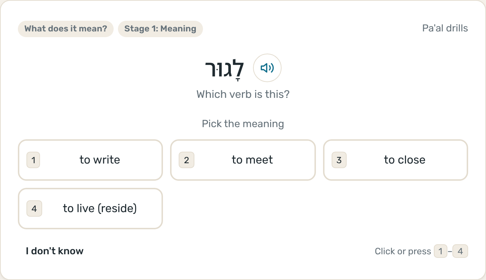</td>
</tr>
<tr>
<td><b>Build from word tiles.</b> For sentences, you tap the words in order (right to left). Some extra tiles are the
<b>wrong-gender</b> versions, such as לוֹמֵד next to לוֹמֶדֶת. Tap a placed tile to take it back.</td>
<td>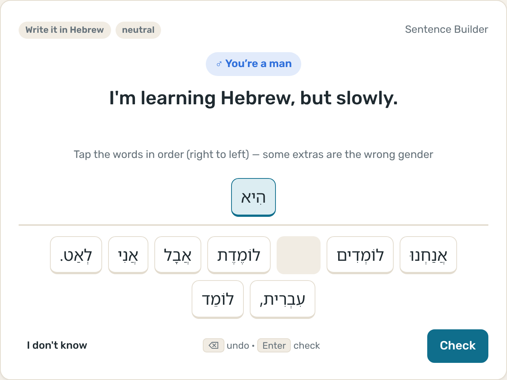</td>
</tr>
<tr>
<td><b>Spell from letter tiles.</b> For verb forms, you spell the word from its letters plus a couple of extra letters that don't
belong. You can also type the letters on your keyboard.</td>
<td>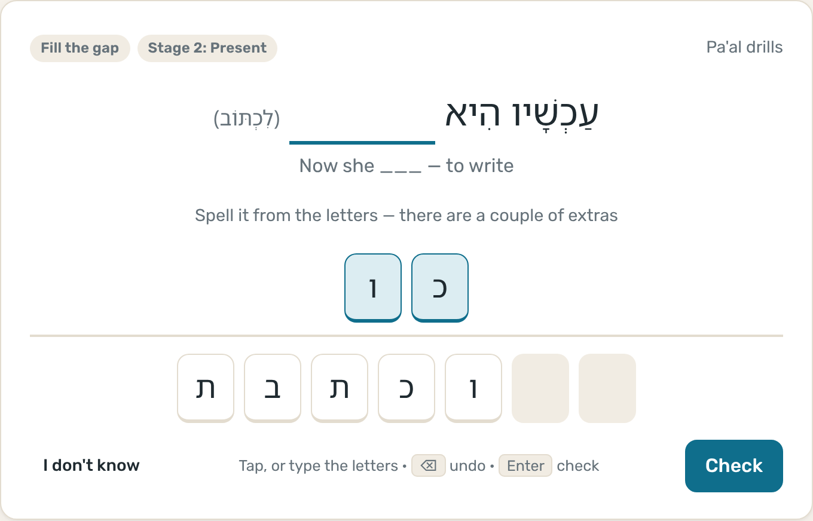</td>
</tr>
<tr>
<td><b>Fill in the missing letters.</b> The word appears with one to three letters missing, usually the ones people mix up:
ו/י, כ/ח/ק, ת/ט, א/ע, ס/ש. Tap a letter from the bank (it includes look-alikes) or type it in the box.</td>
<td>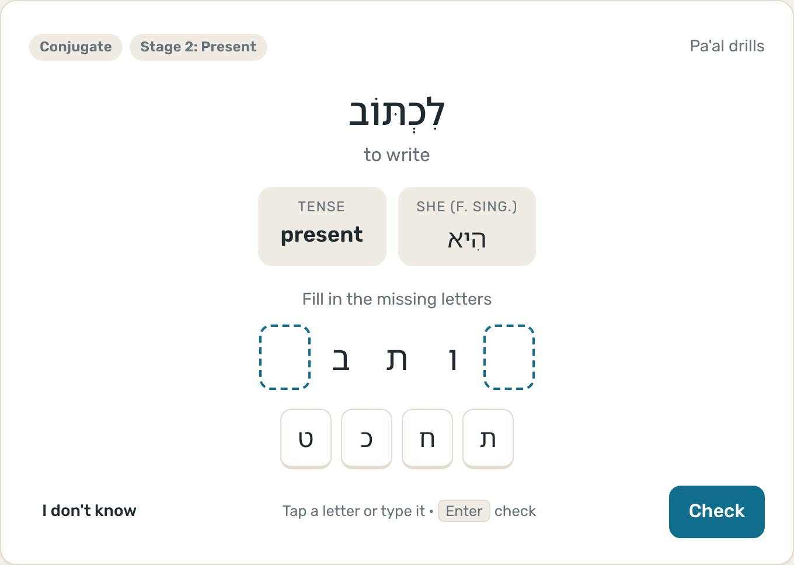</td>
</tr>
<tr>
<td><b>זֶה / זֹאת / אֵלֶּה + type.</b> For nouns, you pick the right demonstrative, which means knowing the noun's gender, then
type the noun.</td>
<td>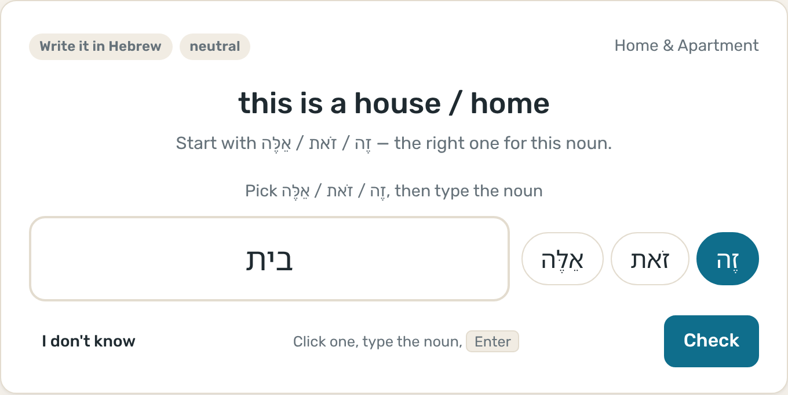</td>
</tr>
<tr>
<td><b>Type it.</b> Once a card is familiar, you type the whole answer. You don't need niqqud. Small slips count as
<i>Almost</i> rather than wrong, and the answer is also checked for agreement (next section).</td>
<td>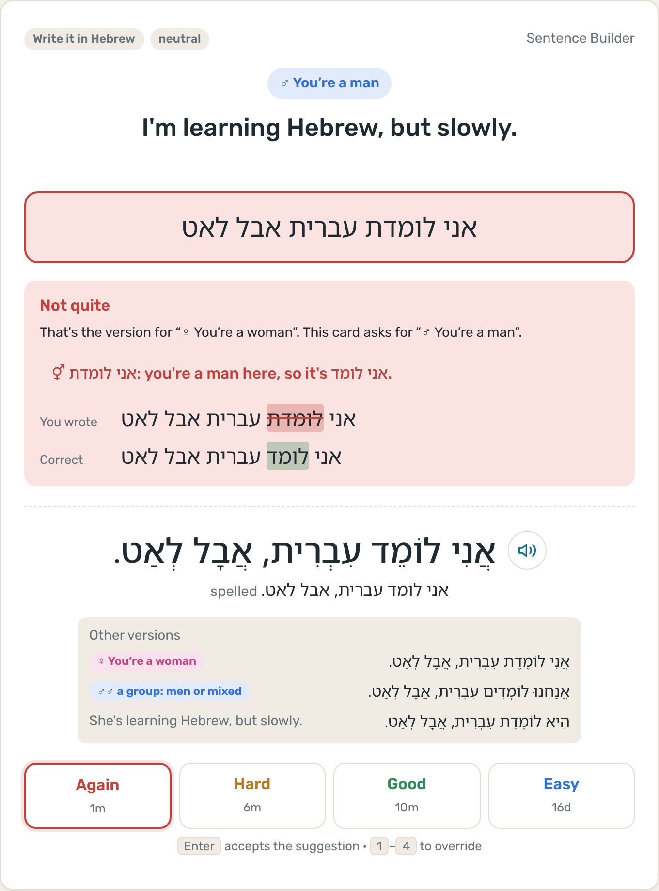</td>
</tr>
</table>

### 5. Gender and agreement

Hebrew marks gender almost everywhere, so the app drills it constantly.

**Nouns always come with זֶה / זֹאת / אֵלֶּה.** For example, *"this is a table"* = **זֶה שֻׁלְחָן** and *"these are shoes"* =
**אֵלֶּה נַעֲלַיִים**. If you leave out the demonstrative or pick the wrong one, the card tells you.

**Sentences come in versions.** A coloured badge above the prompt tells you which version this card wants:

| Badge | Meaning | Example |
|---|---|---|
| ♂ You're a man | you're speaking, as a man | אֲנִי **לוֹמֵד** עִבְרִית |
| ♀ You're a woman | you're speaking, as a woman | אֲנִי **לוֹמֶדֶת** עִבְרִית |
| →♂ / →♀ | you're talking **to** a man / a woman | **אַתָּה** / **אַתְּ** יָכוֹל**ָה**… |
| →♂♀ talking to a group | you're talking to several people | **אַתֶּם יְכוֹלִים**…, **תַּגִּידוּ** |
| ♂♂ a group: men or mixed | "we" or "they", masculine | אֲנַחְנוּ **לוֹמְדִים** |
| ♀♀ a group of women | "we" or "they", feminine | אֲנַחְנוּ **לוֹמְדוֹת** |
| (no badge, English says "he"/"she") | talking about someone | **הִיא** לוֹמֶדֶת |

Each time a card comes back it can show a different version, so over time you practise every person and gender.

**The checker reads what you type.** It checks that:

- adjectives and verbs agree with their noun (דִּירָה **קְטַנָּה**, not קָטָן);
- predicates agree with the pronoun (**הִיא** עֲיֵפָה), including "I" against the badge;
- commands fit who you're talking to (**בּוֹא** to a man, **בּוֹאִי** to a woman, **בּוֹאוּ** to a group).

A gender mistake always makes the answer wrong, and the app explains it, e.g. *"you're a man here, so it's אני לומד"*. If you
typed a correct sentence for a *different* badge, it says so.

The **Gender & agreement** explainer (under Grammar) covers the rules in one page.

### 6. Writing tasks

<p align="center">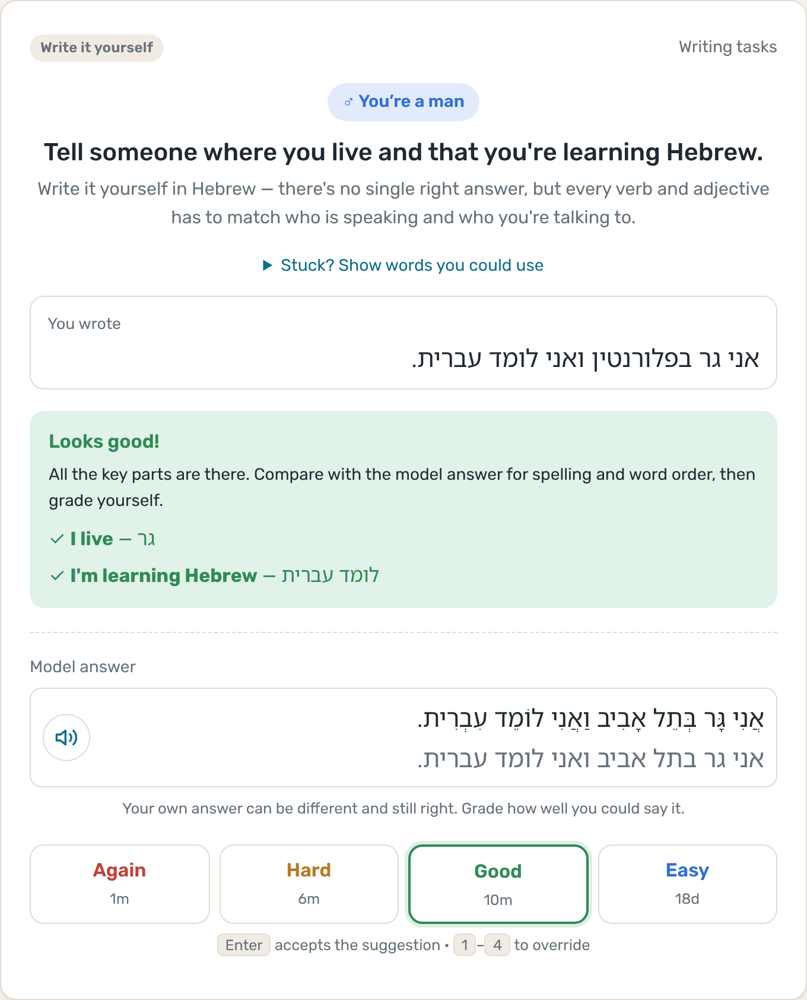</p>

Each lesson ends with short writing tasks, such as *"Tell someone where you live and that you're learning Hebrew."*

- **Write it your own way.** There's no single right answer.
- **The app checks the key parts.** For example, it looks for *I live* (גר / גרה) and *I'm learning Hebrew*. Anything missing is
  listed.
- **Every verb and adjective must match the badge** (who's writing, and who to).
- **Stuck?** *Show words you could use* lists useful vocabulary.
- **Afterwards** you see a model answer to compare with, then grade yourself.
- **Enter** submits. **Shift+Enter** starts a new line.

### 7. Scenarios

<p align="center">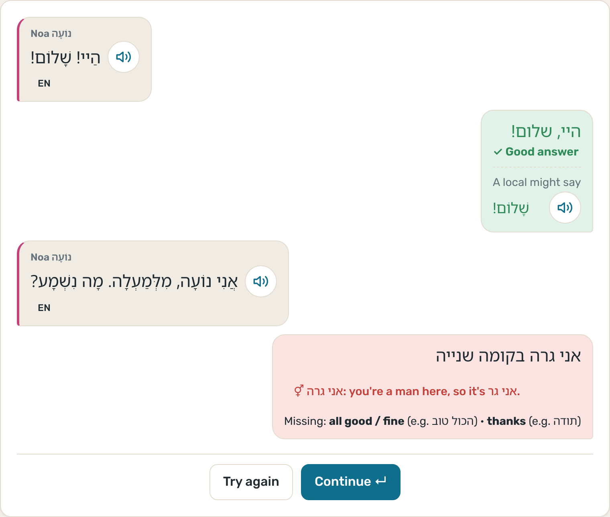</p>

The **Scenarios** tab has one conversation per lesson, set somewhere real in Tel Aviv. You meet the new neighbour, order breakfast,
chat with a taxi driver, see the doctor at the kupat cholim, and so on. Each uses the words from its lesson and everything
before it.

- **A scenario opens** when its lesson is 80% learnt, or when you've skipped that lesson.
- **Choose who you are:** ♂ or ♀, or let it alternate each time you play. Every other character has a fixed gender, shown next to
  their name.
- **Reply in your own words.** A short cue tells you what to say, e.g. *"Say hello back"*. Your reply needs the key parts, and its
  gender must match both you and the person you're talking to.
- **Help when you need it:**
  - **Hint** shows the key parts your reply needs.
  - **🧩 Word tiles** gives you the words to build a reply. Some of them are the wrong gender or don't belong. Using tiles means
    that reply doesn't score.
  - **EN** translates a line. **Show English** translates every line.
- **After each reply** you see *"A local might say…"* with a natural model answer.
- **Your score** is how many replies you got right first time. Play again as the other gender to practise the other forms.

Scenarios are optional and never change your review schedule.

### 8. Verbs

<p align="center">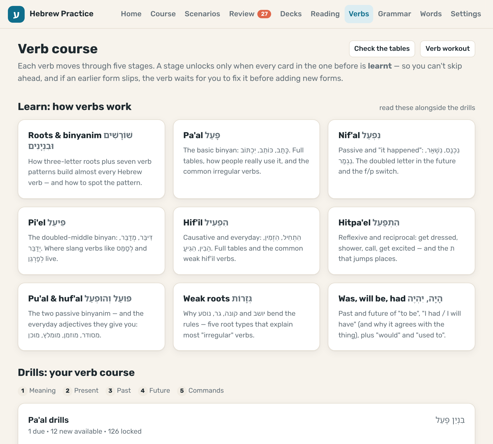</p>

The verb course runs alongside the main course. The course brings verbs in for you, but you can also study the verb decks
directly from this page.

**Each verb goes through five stages:** **Meaning** (the infinitive) → **Present** → **Past** → **Future** → **Commands**.

- **A stage opens only when every form in the one before it is learnt** and has survived one more review. If an earlier form slips,
  the verb waits until you've fixed it. You can loosen this in Settings.
- **New forms go step by step:** choose between real forms of the same verb → spell from letter tiles → fill in the missing
  letters → type.
- **Once a form is familiar, reviews rotate through four formats:**
  - **Conjugate:** you're given the infinitive and a person, such as *she, present*.
  - **Fill the gap:** you complete a sentence, e.g. *עַכְשָׁיו הִיא ___ (לִכְתּוֹב)*.
  - **Transform:** you turn a form you know into another person or tense.
  - **What does it mean?:** you read a form like כָּתַבְתְּ and pick *"you (f) · past · to write"*.
- **The answer panel** shows the whole tense table, with the form you just did highlighted. It also notes textbook versus
  spoken forms.
- **Verb workout** drills everything you've learnt in random order without touching your schedule. It's good for a quick
  warm-up.
- **Check the tables** shows every conjugation table on one page. You can copy them all as text to send to a teacher.
- **Report a mistake:** if a form looks wrong, press **⚐ This looks wrong** on the card. Flagged forms are listed on that page and
  in Settings.

The explainers at the top of the page (roots and binyanim, each binyan, weak roots, "was / will be") are optional background
reading.

### 9. Reading Hebrew and cursive

<p align="center">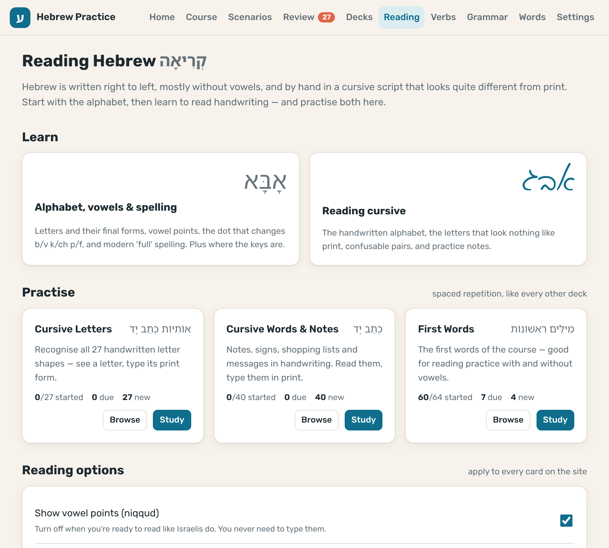</p>

The **Reading** tab teaches reading itself:

- **The alphabet:** letters, final forms, vowel points, the dot that changes ב/כ/פ, and full spelling.
- **Typing on a Hebrew keyboard.**
- **Cursive:** handwritten Hebrew looks very different from print. Two decks drill it:
  - **Cursive Letters:** you see a handwritten letter and type it in print.
  - **Cursive Words & Notes:** the same with whole words.

On any reading card you can switch between print and handwriting with **✍ Show in cursive** (or the **C** key). There's also a
Settings option to show all reading cards in cursive.

### 10. Grammar explainers

<p align="center">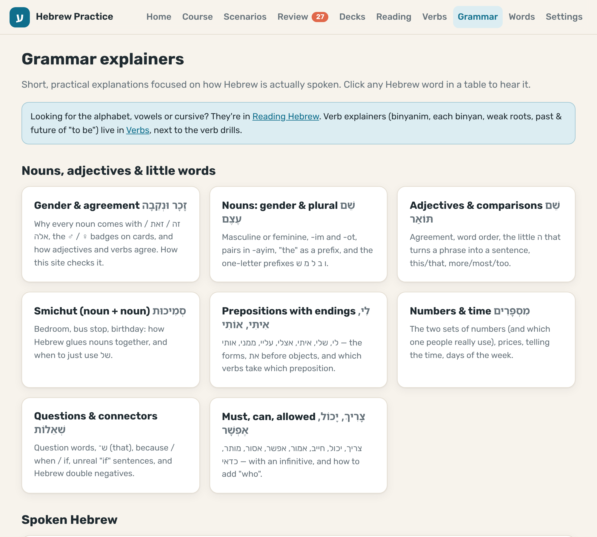</p>

The **Grammar** tab has short, practical pages on:

- gender and agreement, and noun gender and plurals
- adjectives and comparisons
- smichut (noun + noun, like בֵּית קָפֶה)
- prepositions with endings (לִי, אִיתִּי, שֶׁלִּי…)
- numbers and time
- questions and connectors
- must, can, allowed
- *how people actually talk*: the gap between textbook and street Hebrew

Course lessons link to the relevant page. In the tables, tap a Hebrew word to hear it.

### 11. Decks, Words and your own words

- **Decks:** all the topic decks (café, food, home, health, work, slang, verbs…). The course pulls from these automatically. If you
  also want to study a whole deck on its own, switch on **In daily mix**, or open it and press **Study**.
- **Words:** a searchable dictionary of everything in the app. Search in English or Hebrew. Each entry shows the noun's gender
  (זֶה / זֹאת / אֵלֶּה), its versions, notes and examples.
- **Add your own words** (**+ Add your own** on the Words page): heard something new? Add it with its meaning, other accepted spellings, a hint,
  the register and the gender. It goes into the **My Words** deck and is reviewed like everything else.

### 12. Settings

<p align="center">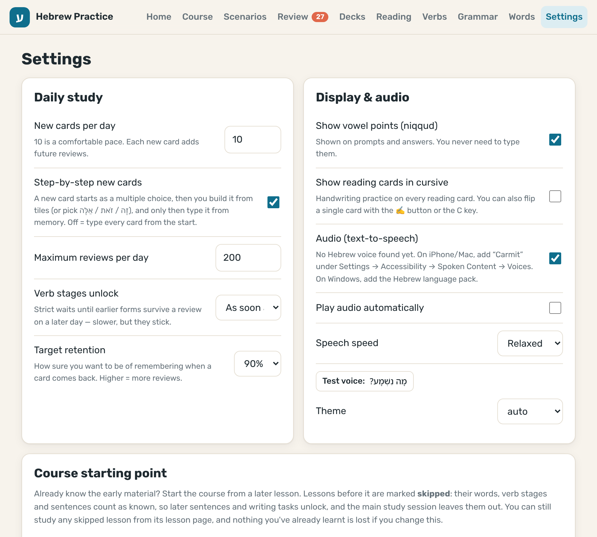</p>

| Setting | What it does |
|---|---|
| **New cards per day** | How many new cards a day (default 10). Each new card adds future reviews, so raise it slowly. |
| **Step-by-step new cards** | On: new cards go choose → build → fill in → type. Off: type every card from the start. |
| **Maximum reviews per day** | A safety cap for the days after a break. |
| **Verb stages unlock** | *Strict* (recommended): a form must be learnt and survive one more review. *As soon as learnt*: faster. |
| **Target retention** | How much you want to remember (90% default). Higher means more reviews. |
| **Show vowel points** | Show niqqud on prompts and answers. You never have to type them. |
| **Show reading cards in cursive** | Handwriting practice on every reading card. |
| **Audio / Play automatically / Speech speed** | Text-to-speech using your device's Hebrew voice. |
| **Theme** | Light, dark or automatic. |
| **Start the course from** | Skip lessons you already know. Everything before the chosen lesson counts as learnt. |
| **Backup / Restore** | Download your progress as a file, or load it back (see below). |

### 13. Your progress and backups

All your progress (cards, history, settings, scenario scores) lives in this browser's local storage, on this device.

- **Back up regularly:** **Settings → Download backup** saves a small `.json` file. The app reminds you if it's been a while.
- **Moving to another device or browser:** download a backup on the old one, then use **Settings → Restore from backup** on the
  new one.
- **Clearing your browser data, or using a private window, erases your progress.** Keep a backup.

### Keyboard shortcuts

| Key | When | Does |
|---|---|---|
| **Enter** | typing an answer | Check |
| **Enter** / **Space** | after answering | Accept the suggested grade |
| **1 2 3 4** | after answering | Again / Hard / Good / Easy |
| **1–4** | multiple choice | Pick that option |
| any Hebrew letter | letter tiles | Pick a matching tile |
| **⌫ Backspace** | tiles or letter boxes | Undo the last tile or letter |
| **Space** / **Enter** | reading card (no choices) | Show the answer |
| **C** | reading card | Switch between print and cursive |
| **R** | after answering | Play the audio again |
| **Z** | any time | Undo your last grade |
| **Shift+Enter** | writing task or scenario | New line |

### Tips and FAQ

<p align="right">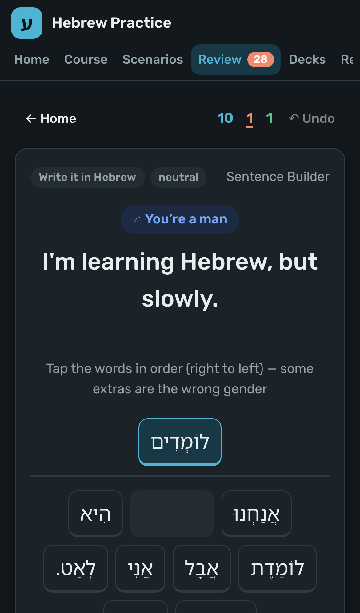</p>

- **Little and often beats long sessions.** Do your reviews daily, even on days you add nothing new.
- **Be honest when you grade.** If you hesitated, pick *Hard*. Fooling the scheduler only means forgetting later.
- **Say every answer out loud,** and tap 🔊 to compare.
- **Too many reviews?** Lower *New cards per day* for a week. Reviews settle down quickly.
- **"Why was my answer wrong? It's a real word!"** It may be the right word in the wrong gender or person. Read the explanation
  under the verdict.
- **"I typed it without vowels, is that OK?"** Yes, always. Vowel points are only there to help you read.
- **"The audio doesn't work."** Your device needs a Hebrew text-to-speech voice. On iPhone and Mac, add one under Accessibility →
  Spoken Content → Voices → Hebrew.
- **"Can I trust the Hebrew?"** The content was written carefully and passes automatic grammar checks, but it hasn't all been
  checked by a native speaker yet. If something looks off, flag it on the card or open an issue.

<br clear="right">

---

## For developers

The site is plain HTML, CSS and JavaScript (ES modules), with no build step. It's served by GitHub Pages from the `main` branch.

```bash
python3 -m http.server 8000   # then open http://localhost:8000
npm run validate              # all content checks (also run by GitHub Actions on every push)
```

**Where things live**

| Path | What |
|---|---|
| `index.html`, `css/`, `js/` | The app. `js/views/` holds one file per page; `js/views/interact.js` has the choose / tiles / fill-in widgets. |
| `data/decks/*.json` | Vocabulary, sentence, verb and cursive decks, listed in `data/decks/index.json`. |
| `data/course.json` | The 24 lessons. Generated: edit `tools/course/build.py` and rerun it. |
| `data/scenarios.json` | The scenarios. Generated by `tools/scenarios/scenarios.py`. |
| `data/agree.json` | The gender lexicon for the agreement checker. Generated by `tools/gender/apply.py`. |
| `data/grammar/*.html` | Grammar explainers, listed in `data/grammar/index.json`. |
| `tools/validate-*.mjs` | Checks for verb tables, the course, gender versions and scenarios. |

**Rebuild the generated data**

```bash
python3 tools/course/build.py .   # also runs the gender step
```

```bash
python3 tools/scenarios/scenarios.py .
```

```bash
npm run validate
```

**Content notes**

- **Items:** each one has an `id`, `he` (full spelling with niqqud) and `en`. Optional fields are `alt` (other accepted answers),
  `hint`, `reg`, `note`, `ex`, `g` (noun gender: `m` / `f` / `mp` / `fp`) and `v` (gendered versions). **Keep `id`s stable,
  because review history is keyed by them.**
- **Lesson verb references** look like `paal/katav@present`. The stages are `inf`, `present`, `past`, `future` and `imp`.
- **The course validator** checks:
  - that every reference exists;
  - that sentences and writing tasks only use words already taught;
  - that every lesson word and verb stage is practised in a writing task;
  - that every model answer passes its own checklist.
- **The gender validator** checks every version of every sentence against the agreement checker.
- **Verb tables** are checked automatically: niqqud, final letters, root letters, person prefixes and endings. Each verb shows
  *not yet checked* until a native speaker signs it off with `"review": {"status": "checked", "by": "…"}`.
